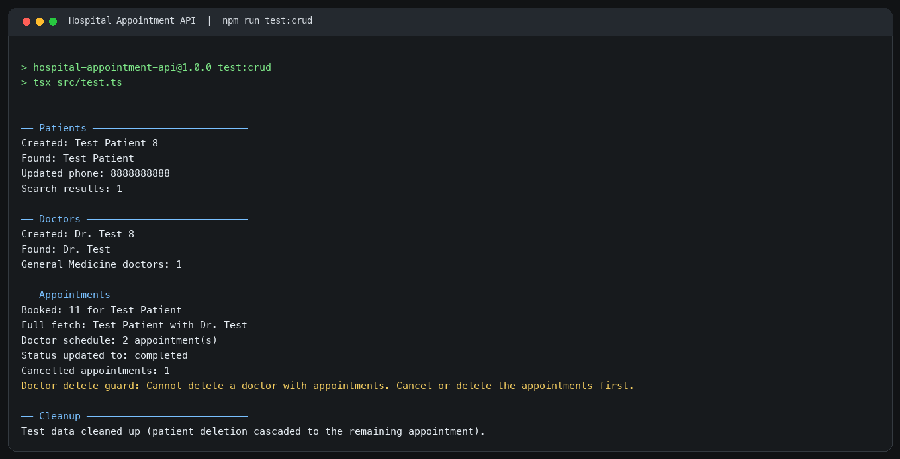

# Hospital Appointment API

A TypeScript CRUD module for patients, doctors, and hospital appointments using Prisma 7 and PostgreSQL. The Prisma models use clean TypeScript names while `@map` and `@@map` keep them connected to the existing snake_case database schema.

## Requirements

- Node.js 20 or later
- PostgreSQL

## Setup

1. Install dependencies with `npm install`.
2. Create the database and its three tables:

   ```sh
   createdb hospital_api
   psql -d hospital_api -f prisma/setup.sql
   ```

3. Copy `.env.example` to `.env` and set `DATABASE_URL` to your PostgreSQL connection string. `.env` is ignored by Git.
4. Introspect the existing database if desired with `npm run db:pull`. Review the mapped names in `prisma/schema.prisma`, then generate the Prisma Client:

   ```sh
   npm run db:generate
   ```

The project does not use migrations because the tables already exist. `prisma/setup.sql` is included to reproduce the database from scratch.

## Commands

```sh
npm run db:seed       # Replace table contents with sample records
npm run test:crud     # Exercise the patient, doctor, and appointment CRUD functions
npm run typecheck     # Check TypeScript types
```

The seed and CRUD scripts use future appointment dates so upcoming-schedule queries remain meaningful whenever they are run.

## CRUD test output



## CRUD functions

- Patients: create, fetch by ID, search by name, update phone, delete
- Doctors: create, fetch by ID, list by specialty, delete with a clear foreign-key restriction error
- Appointments: book with relational `connect` and nested `include`, fetch full details, list a doctor's upcoming appointments, change status, cancel a patient's scheduled appointments, delete

Deleting a patient cascades to their appointments. A doctor cannot be deleted while appointments reference them; cancel or delete those appointments first.
